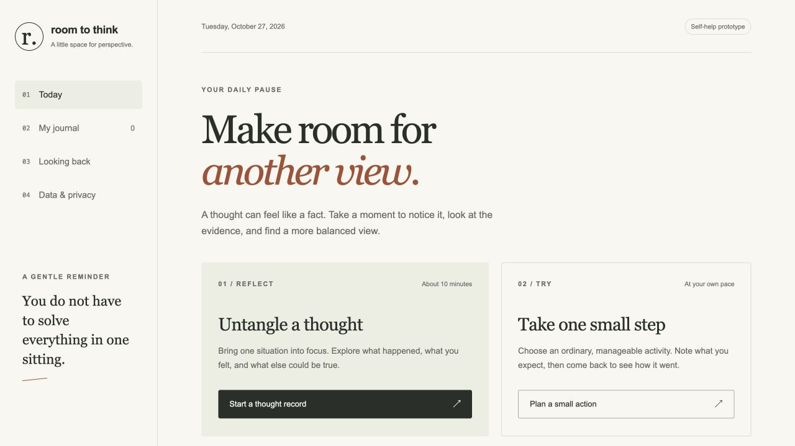

# Cognitive Behavioral Therapy — Room to Think

A small CBT-informed reflection journal that runs in your browser. Write a thought record, plan a manageable activity, revisit saved entries, and look back at your own feeling ratings. No account, model, API key, or runtime dependency is needed.

**This is an unsupervised self-help prototype.** It has no therapist or AI, does not diagnose or assess a mental health condition, and has not been clinically evaluated. It does not establish the therapeutic claims previously shown in a portfolio description. If you need support, contact a qualified professional. For immediate danger, contact local emergency services.



*Actual application screenshot, captured with no personal journal data.*

## Run locally

Requires Node.js 22 or newer.

```sh
git clone https://github.com/ungaaaabungaaa/cognitive-behavioral-therapy.git
cd cognitive-behavioral-therapy
npm ci
npm start
```

Open <http://127.0.0.1:8793>. The server binds only to IPv4 loopback. Keep the same address and port to see the same browser journal. Use `PORT=8794 npm start` to choose another port on macOS/Linux; a different port has separate browser storage.

```sh
npm run check
npm run test:coverage
```

`npm run build` copies only four public app files into `dist/`. See [deployment instructions](docs/deployment.md) before hosting.

## What works

- **Thought records:** situation, feeling and intensity, automatic thought, supporting and opposing observations, balanced view, and optional later rating.
- **Small-action plans:** activity, when/where, expected outcome, and optional observed outcome with a later feeling rating. Edit a plan after you try it.
- **Journal:** view, filter, edit, or delete your own entries. Unsaved forms are not stored; navigation warns before discarding them.
- **Looking back:** actual entry counts, paired subjective ratings, and recent writing activity. A higher later rating is reported as higher. There is no wellbeing score, diagnosis, streak, or treatment claim.
- **Backups:** download unencrypted JSON; validate an import, preview its count, then confirm replacement. Invalid data is rejected before writing.

The original prompts draw on public NHS explanations. [Sources and scope](docs/sources.md) explain the distinction between this prototype and practitioner-supported treatment.

## Privacy and recovery

Entries stay in `localStorage` for the exact browser origin. They are **not encrypted**. Someone with access to the browser profile may be able to read them. Use a private device. There is no journal upload, analytics, external font, remote script, service worker, or automatic draft storage. Opening a source link contacts that external site.

Clearing browser/site data or losing this device can lose the journal. Private browsing may discard it. Export a backup if you want to keep your entries. A backup is plain personal text; protect it yourself.

The journal accepts at most 200 entries and a 1 MiB serialized backup. Text fields are limited to 2000 characters. Failed storage writes retain the previous in-memory state. Malformed stored data blocks saving and offers a raw recovery download before reset. A stale-tab check rejects saves when another tab has changed the stored journal; it is not a multi-user database transaction. For sensitive or shared-device use, this prototype's local storage is not sufficient protection.

See [the runtime and data contract](docs/runtime-contract.md), [security notes](SECURITY.md), and [verification record](docs/verification.md).

## Project files

| Path | Purpose |
| --- | --- |
| `src/model.mjs` | Validated entries, backup limits, storage adapter, descriptive summaries |
| `src/app.mjs` | Browser forms, navigation, journal, backup and progress behavior |
| `src/styles.css` | Responsive paper-and-ink interface, no external assets |
| `scripts/serve.mjs` | Fixed-file loopback server and security headers |
| `scripts/build.mjs` | Deterministic static copy with no private data |
| `tests/` | Behavior, failure handling, import and server boundary checks |

## Repository history

On 27 October 2026, the existing NotesBuddy repository became this project. Its original Android notes-sharing application remains on [`archive/before-cbt-2026-10-27`](https://github.com/ungaaaabungaaa/cognitive-behavioral-therapy/tree/archive/before-cbt-2026-10-27), at `8d9c0efe2b0e86636c782ac5442dbc6f33cae774`. Earlier commits and stars predate this implementation. The old code was not reused. The MIT license applies to the new project files; it does not relicense legacy archive content.

The repository cover is pending user approval and is not included. No portfolio source or deployment was changed.
